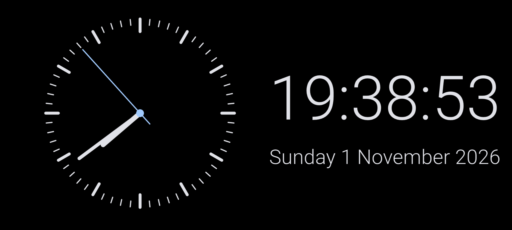
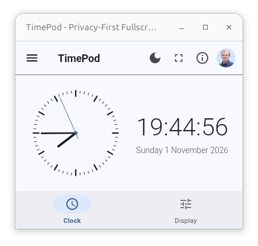

# TimePod - Privacy-First Fullscreen Clock

[TimePod](https://gjwgit.github.io/timepod/) shows a large clock,
analog, digital or both, with the weekday and date. Tap
**Fullscreen** to fill the screen with the clock and keep the screen
awake. Leave it running on a spare phone, tablet or monitor as a
bedside or desk clock. The fullscreen clock drifts a little every
minute so an OLED screen does not burn in. Under **Display** choose
what the clock shows: the analog face, the digits, the date, the
seconds, and 24 or 12 hour time.

The app needs no login and sends nothing anywhere. Logging in to your
own personal online data store (Pod) is optional, ready for features
that keep your data private and encrypted on your own Pod. Pods are
an innovation from the inventor of the World Wide Web, Sir Tim
Berners-Lee. For more information visit the [Solid
Project](https://solidproject.org). **You do not need a Solid Pod to
use this app.**

TimePod is based on [Fullscreen
Clock](https://github.com/schorschii/FsClock-Android) 2.2 by Georg
Sieber, an Android app that is also free software under the GNU
General Public License version 3.

The app is developed by [Togaware](https://togaware.com) and
implemented by Claude Code under the supervision of [Graham
Williams](https://togaware.com/Graham.Williams.html) using
[Flutter](https://flutter.dev) for cross platform deployment.

We make this project available for free so if you appreciate the app
then please show some ❤️ and tap on the star at
[GitHub](https://github.com/gjwgit/timepod) to support our work. See
the [AU Solid Community](https://solidcommunity.au) **showcase** for
our apps using the Solid ecosystem.

## Installation

See the [Install
Guide](https://gjwgit.github.io/timepod/INSTALL.html) for
installation instructions for any platform.

## Screens

Here we walk through TimePod on various platforms and use cases. Every
screen looks the same across the devices from phones, tablets,
desktops and in a browser. As with all solidui apps, the screen size
is remembered on restarting the app.

To just try it out witjhout any installation required, visit [TimePod
Web](https://timepod.solidcommunity.au).

### The Family Room Clock

The app can be installed on a retired Android phone and sit in the
family room as the family clock. We get into this mode with a tap of
the full screen icon in the top toolbar to display the clock over the
whole screen, while turning off the screen sleep mode. Tap in the
window to restore to the original app.

### The Desktop Clock

The app can sit inconspicuously in a small window on your computer's
desktop. Dark mode and light mode are supported. Tap the full screen
icon in the top toolbar to display the clock over the whole screen,
while turning off the screen sleep mode. Tap the `ESC` key or click in
the window to restore to the original window.

On a technical note we see here the standard
[solidui](https://pub.dev/packages/solidui) scaffold that houses the
TimePod app including the top toolbar and the bottom app buttons.

## Roadmap

TimePod is built using the [SolidUI](https://solidcommunity.au)
framework. This framework utilises open standard Solid Servers to
store any data within your personal online datastore (Pods). At this
time (November 2026) the Pod functionality is not utilised no data is
collected by the app nor shared with anyone. I do plan to support Pods
eventually whre calendar events can be securely and privately stored
and shared, if you choose, with other TimePod users. Some of the
functionality below will depend on supporting Solid Pods.

+ Add a calendar function to record event dates and times. A popup
  will appear at that date/time with the correspending event
  details. The popup remains until dismissed.

+ Allow individual events to be share with other Pods. A family might
  all be running TimePod to have the reminders popup for everyone.

+ Access RoloPod data within the user's Pod to catch birthdays,
  wedding anniversaries, etc, and then popup a reminder in TimePod the
  day before.
